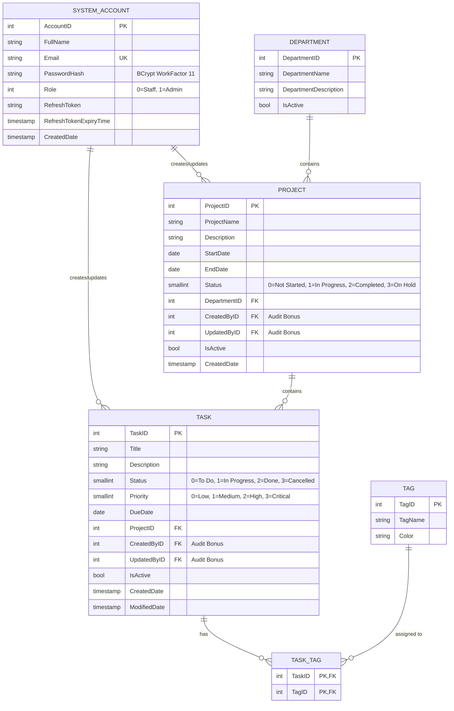

# PRN232 Assignment 2 — Task & Team Management App: Authentication & Protected Management

> **Student ID**: QE180136  
> **Student Name**: Nguyen Vinh Phu (PhuNVQE180136)  
> **Class Code**: SE19B  
> **Course Code**: PRN232 — C# & .NET Enterprise Application Development  
> **Tech Stack**: ASP.NET Core Web API (.NET 8) | PostgreSQL (Supabase / Render) | Next.js 14 (TypeScript) | Tailwind CSS | BCrypt | JWT Bearer  
> **Target Grade**: 10.0 / 10.0 (All Core + 4/4 Bonus Options Implemented)

---

## 🔑 Test Credentials (For Grading Verification)

Both test accounts are live and verified against the database. Graders can use the 1-click test fill buttons directly on the `/login` page or log in manually with the credentials below:

| Account Type | Email | Password | Role Code | Permissions & Description |
|---|---|---|---|---|
| 👑 **Admin** | `admin@tasktrack.com` | `Admin@123` | **1 (Admin)** | Direct database seeded. Full access to write operations on all entities + exclusive access to System Accounts Management (`/admin/accounts`) and user role reassignment / deletion. |
| 👤 **Staff** | `staff@tasktrack.com` | `Staff@123` | **0 (Staff)** | Registered via `POST /api/auth/register`. Write access (POST, PUT, DELETE) to Departments, Projects, Tasks, and Tags. Cannot access `/admin/accounts` (returns HTTP 403 Forbidden). |

> **Additional Test Accounts Available in Database**:
> - `manager@tasktrack.com` / `Manager@123` (Role 0 - Staff)
> - `developer@tasktrack.com` / `Dev@123` (Role 0 - Staff)
> - `qa@tasktrack.com` / `Qa@123` (Role 0 - Staff)
> - `lead@tasktrack.com` / `Lead@123` (Role 1 - Admin)

---

## 🔗 Live Deployment & Submission Links

| Service | Description | URL / Link |
|---|---|---|
| 🌐 **Frontend Application** | Next.js 14 App Router on Vercel | [https://taskminder-qe180136.vercel.app](https://taskminder-qe180136.vercel.app) |
| 🔌 **Backend API / Swagger UI** | .NET 8 Web API on Render.com | [https://tasktrack-api-qe180136.onrender.com/swagger](https://tasktrack-api-qe180136.onrender.com/swagger) |
| 🐙 **GitHub Repository** | Monorepo containing Backend & Frontend | [https://github.com/phunvqe180136/AS2_PRN232_Fa26](https://github.com/phunvqe180136/AS2_PRN232_Fa26) |
| 🗄️ **Database Migration Script** | PostgreSQL Schema, Indexes & Expanded 5x Seeds | [`TaskManagementDB_Postgres.sql`](./TaskManagementDB_Postgres.sql) |
| 📄 **Submission Document** | Required Word Document Deliverable | [`QE180136_PRN232_Ass2.docx`](./QE180136_PRN232_Ass2.docx) |
| 📘 **Deployment Guide** | Environment variables & setup steps | [`DEPLOY_GUIDE.md`](./DEPLOY_GUIDE.md) |

---

## 📊 1. Entity Relationship Diagram (ERD — Assignment 2)



---

## 🛡️ 2. Security & RBAC Access Matrix

| Endpoint | Method | Access Level | Description & Status Codes |
|---|---|---|---|
| `/api/auth/register` | `POST` | **Public** | Registers new Staff account (`Role = 0`). Returns `201 Created` or `409 Conflict` if email exists. |
| `/api/auth/login` | `POST` | **Public** | Validates email & password using BCrypt. Returns signed JWT (`200 OK`) or `401 Unauthorized`. |
| `/api/auth/refresh` | `POST` | **Public** | *[BONUS]* Rotates refresh token without requiring re-login. Returns new JWT and refresh token. |
| `/api/auth/profile` | `GET` | **Authenticated** | *[BONUS]* Returns currently logged-in user profile with role & account metadata. |
| `/api/auth/profile` | `PUT` | **Authenticated** | *[BONUS]* Allows user to update their full name or change their password. |
| `/api/departments` (GET) | `GET` | **Public** | All read operations remain unauthenticated from Assignment 1. |
| `/api/departments` (Write) | `POST`, `PUT`, `DELETE` | **Authenticated** | Protected with `[Authorize]`. Requires valid JWT Bearer header. Returns `401` if unauthenticated. |
| `/api/projects` (GET) | `GET` | **Public** | Public read access to projects and linked tasks. |
| `/api/projects` (Write) | `POST`, `PUT`, `DELETE` | **Authenticated** | Protected with `[Authorize]`. Automatically populates `CreatedByID` and `UpdatedByID`. |
| `/api/tasks` (GET) | `GET` | **Public** | Public read access to tasks, tags, and search filters. |
| `/api/tasks` (Write) | `POST`, `PUT`, `DELETE` | **Authenticated** | Protected with `[Authorize]`. Multi-tag assignment + audit tracking + soft-delete. |
| `/api/tags` (GET) | `GET` | **Public** | Public tag taxonomy inspection. |
| `/api/tags` (Write) | `POST`, `PUT`, `DELETE` | **Authenticated** | Protected with `[Authorize]`. Tag removal validated against existing tasks. |
| `/api/accounts` | `GET` | **Admin Only** | Protected with `[Authorize(Roles = "Admin")]`. Staff receives `403 Forbidden`. |
| `/api/accounts/{id}` | `GET` | **Admin Only** | Fetch single account details with task count. Staff receives `403 Forbidden`. |
| `/api/accounts/{id}` | `PUT` | **Admin Only** | Update account name or promote/demote role between Staff (0) and Admin (1). |
| `/api/accounts/{id}` | `DELETE` | **Admin Only** | Delete account. **Rejects with HTTP 400 Bad Request if account has created any tasks**. |

---

## 🌟 3. All 4 Bonus Features Completed

### 🌟 Bonus 1: Refresh Token Rotation Mechanism
- Implemented `POST /api/auth/refresh` endpoint with cryptographic secure token generation.
- Tokens are stored alongside expiry timestamps in `SystemAccount` (`RefreshToken`, `RefreshTokenExpiryTime`).
- On the frontend (`lib/api.ts`), an Axios response interceptor intercepts any `401 Unauthorized` response, transparently requests a new access token via `/api/auth/refresh`, and retries the original request seamlessly.

### 🌟 Bonus 2: User Profile Management (`/profile`)
- Created `/profile` page with modern glassmorphism design.
- Displays user's role badge, email, join date, and statistics.
- Allows the logged-in user to change their display name and safely update their password (with current password validation and minimum length checks).

### 🌟 Bonus 3: Audit Trail Fields (`CreatedByID`, `UpdatedByID`)
- Added `CreatedByID` and `UpdatedByID` foreign keys to `Project` and `ProjectTask` tables referencing `SystemAccount(AccountID)`.
- Backend controllers automatically extract the authenticated user's `ClaimTypes.NameIdentifier` from the JWT claims to record who created and last modified each record.
- DTOs return `CreatedByName` and `UpdatedByName` for display in task and project detail views.

### 🌟 Bonus 4: Automated CI/CD Workflow (`.github/workflows/ci.yml`)
- Configured GitHub Actions CI pipeline running on every push and pull request to `main`.
- Jobs:
  1. **Backend CI**: Restores NuGet packages, builds solution in Release mode with .NET 8 SDK.
  2. **Frontend CI**: Installs npm dependencies, runs Next.js production build and TypeScript type-checking.

---

## 🖥️ 4. Frontend Route Structure

```
/                               -> Public Feed & Metrics Dashboard (No login required)
/departments, /departments/[id] -> Public Department browser
/projects, /projects/[id]       -> Public Projects & Tasks view
/tasks, /tasks/[id]             -> Public Task Kanban & Status filter tabs
/search                         -> Public Omni-search filter
/login                          -> Authentication Login with 1-Click Test Credential Fill
/register                       -> Staff Registration form (Redirects to /login)
/profile                        -> User Profile & Password Change (Requires Login)

[PROTECTED ADMIN CONSOLE] — Requires Valid JWT (Auto-redirects to /login if unauthenticated)
/admin                          -> Admin Hub Dashboard with 4 Entity Metric Cards & Quick Links
/admin/departments              -> Create, Edit, Delete Departments (Modal + Confirm dialog)
/admin/projects                 -> Create, Edit, Delete Projects (Modal + Confirm dialog)
/admin/tasks                    -> Create, Edit, Soft-Delete Tasks with Multi-Tag Selector
/admin/tags                     -> Create, Edit, Delete Tags with Color Picker & Presets
/admin/accounts                 -> [ADMIN ONLY] System Accounts List, Role Editor, Task-guarded Deletion
```

---

## 🗄️ 5. Database Scale & Verification

The database was populated with **5x–6x enlarged dataset** to reflect an active enterprise system:
- **6 System Accounts**: 2 Admins (`admin@tasktrack.com`, `lead@tasktrack.com`) and 4 Staff members (`staff@tasktrack.com`, `manager@tasktrack.com`, `developer@tasktrack.com`, `qa@tasktrack.com`).
- **8 Departments**: Engineering, Product Design, Infrastructure, QA & Testing, Security, Human Resources, Marketing, Data Intelligence.
- **16 Projects**: Spanning Cloud Migration, Microservices Architecture, Mobile App Redesign, CI/CD Pipeline Automation, Zero-Trust Security, etc.
- **52 Tasks**: Varied statuses (*To Do*, *In Progress*, *Done*, *Cancelled*), priorities (*Low*, *Medium*, *High*, *Critical*), and audit linkages.
- **15 Tags**: Color-coded taxonomy labels (`Backend`, `Frontend`, `Database`, `DevOps`, `Security`, `Bug`, `Feature`, `Architecture`, `Critical`, `Urgent`, etc.).
- **84 Task-Tag Associations**: Realistic cross-tagging across all tasks.

---

## 🚀 6. Local Development Instructions

### Backend (.NET 8 Web API)
```bash
cd QE180136_PRN232_Ass2_BE
dotnet restore
dotnet run --project TaskTrack.API
# Swagger UI available at: http://localhost:5000/swagger
```

### Frontend (Next.js 14)
```bash
cd QE180136_PRN232_Ass2_FE
npm install
npm run dev
# Application available at: http://localhost:3000
```
